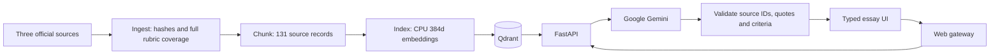

# Stepwise — IELTS writing feedback and model essays

AC215 Milestone 2. Type or paste an IELTS Academic Writing Task 2 essay, receive real rubric-grounded Google Gemini scores and specific revisions, then generate an essay from your target and ideas and inspect its separately assessed scores.

## Run

See [setup instructions](docs/setup.md) for authorized Google Cloud configuration, runtime token refresh and exact commands. With those prerequisites configured:

```bash
make run
```

[Official milestone requirements](https://harvard-iacs.github.io/2026-AC215/milestone2/) · [Application design](docs/application.md) · [Sources and coverage](docs/data.md) · [Engineering decisions](docs/decisions.md) · [Evidence](docs/evidence/README.md)

## Pipeline



Five custom Dockerfiles, five `pyproject.toml`/`uv.lock` pairs and upstream Qdrant are composed in `compose.yaml`. Source locks, chunk manifests, embedding fingerprints and model-call receipts identify what each stage used.

## Official assessment knowledge

All nine pages of the official IELTS Writing Band Descriptors are indexed, including bands 0–9 for both tasks. Task 2 scoring retrieves only applicable Task 2/shared rules. The official Key Assessment Criteria supplies all 20 detailed checks. British Council guidance adds question-relevance examples. See [linked sources](docs/data.md).

Four criterion scores, exact essay evidence, actionable advice and before/after revisions are generated by the model. Source citations and excerpts are checked on the server. Generation preserves requested position/ideas and is followed by a fresh assessment that does not receive the target band.

The 8,049 candidate essay records are **MS3 fine-tuning data**, excluded from MS2 ingestion and RAG. Only their future-use manifest is retained in `data/ms3`.

## Validation

`make test` checks contracts and evidence validation without Google calls. `make verify` tests the live containers and model workflow. `make evidence` records existing validated outputs and logs without additional inference. Current receipts identify the exact model and implementation used; successful integration does not establish agreement with examiner scores.

Historical preview evidence is preserved under `docs/evidence/preview-v1/`; it describes the earlier placeholder implementation and must not be used as proof of current model inference.

Team: Bei Li, Ernest Ferdian, Dimitris Pipinis, Xiahui Huang.
