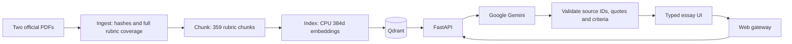

# Stepwise — IELTS writing feedback and model essays

AC215 Milestone 2. Type or paste an IELTS Academic Writing Task 2 essay, receive real rubric-grounded Google Gemini scores and specific revisions, then generate an essay from your target and ideas and explore qualitative writing feedback.

## Current model-essay flow: target writing and commentary

The user-selected policy supersedes the older calibration releases below: **write once, then comment on the actual essay without re-scoring**. The overall number is the preset **Target band**. Position and ideas are optional and blank by default: empty fields reuse the original essay’s stance and relevant ideas; a newly entered position overrides the original stance. Generated essays have no numeric criterion scores, score average or target-matching loop. Four criterion comments, 20 qualitative skill details, actionable next steps, exact excerpts and revision examples remain linked to official IELTS guidance. Normal submitted-draft scoring retains the full 119-statement checks and four-score average. The progress view has two steps. See [current implementation](docs/model-essay-commentary.md).

## Live application

[Open Stepwise](https://stepwise-one.vercel.app) — fixed public URL; no Vercel login is required. Bei Li's complete implementation is on the default `bei-li` branch. `milestone2` retains the existing course delivery snapshot.

Vercel hosts the UI and a same-origin gateway. A restricted, short-lived OIDC identity invokes the private Cloud Run API, whose service account calls Gemini on Vertex AI. The frozen official RAG index contains 359 points; Google credentials are not embedded in the browser.

## Team branches

| Branch | Owner / purpose | Starting contents |
| --- | --- | --- |
| [`bei-li`](https://github.com/dwcqwcqw/stepwise/tree/bei-li) | Bei Li; default view | Complete implementation, report and evidence |
| [`ernest-ferdian`](https://github.com/dwcqwcqw/stepwise/tree/ernest-ferdian) | Ernest Ferdian | Empty workspace |
| [`dimitris-pipinis`](https://github.com/dwcqwcqw/stepwise/tree/dimitris-pipinis) | Dimitris Pipinis | Complete implementation + instructions of running in Windows/macOS|
| [`xiahui-huang`](https://github.com/dwcqwcqw/stepwise/tree/xiahui-huang) | Xiahui Huang | Empty workspace |
| [`main`](https://github.com/dwcqwcqw/stepwise/tree/main) | Shared team integration | Empty workspace |
| [`milestone2`](https://github.com/dwcqwcqw/stepwise/tree/milestone2) | Existing course delivery snapshot | Preserved implementation and submission artifacts |

Member branches provide separate places for development; repository access is managed through GitHub collaborators.

## Run

See [setup instructions](docs/setup.md) for authorized Google Cloud configuration, runtime token refresh and exact commands. With those prerequisites configured:

```bash
make run
```
On Windows or macOS, first see [Running the pipeline in Windows/macOS](#running-the-pipeline-in-windowsmacos).

[Official milestone requirements](https://harvard-iacs.github.io/2026-AC215/milestone2/) · [Application design](docs/application.md) · [Sources and coverage](docs/data.md) · [Engineering decisions](docs/decisions.md) · [Evidence](docs/evidence/README.md)

## Pipeline



Five custom Dockerfiles, five `pyproject.toml`/`uv.lock` pairs and upstream Qdrant are composed in `compose.yaml`. Source locks, chunk manifests, embedding fingerprints and model-call receipts identify what each stage used.


## Running the pipeline in Windows

Run steps A and B below once:

**Step A**
Create a file called `.env` in the repository folder (compose.yaml reads it automatically).

```
GOOGLE_CLOUD_PROJECT=YOUR_PROJECT_ID
GOOGLE_CLOUD_LOCATION=global
GEMINI_MODEL=gemini-3.5-flash
STEPWISE_AUTH_DIR=./runtime/auth
```
**Step B**

2. Sign in to Google (use `gcloud.cmd`, not `gcloud`):

```powershell
gcloud.cmd auth login
gcloud.cmd config set project YOUR_PROJECT_ID
```


## Official assessment knowledge

All nine pages of the official IELTS Writing Band Descriptors are indexed, including bands 0–9 for both tasks. Task 2 scoring retrieves only applicable Task 2/shared rules. The PDF is split into 238 paragraph statements (119 for Task 2), with independent vectors, parent cells and exact page links. Each of the four independent assessment calls checks every official integer band and its bold limiting features. The UI prioritizes current/next-band matches and shows the exact criterion mean before half-up conversion to a 0.5 practice estimate. The official Key Assessment Criteria supplies 20 supplementary skill checks. See [linked sources](docs/data.md).

Four criterion scores, exact essay evidence, actionable advice and before/after revisions are generated by the model. Source citations and excerpts are checked on the server. Generation uses official target-band guidance, preserves the requested position/ideas and adds qualitative comments, exact excerpts and examples in one feedback call. The preset target is shown as Target band; generated essays are not re-scored.

The 8,049 candidate essay records are **MS3 fine-tuning data**, excluded from MS2 ingestion and RAG. Only their future-use manifest is retained in `data/ms3`.

## Validation

`make test` checks contracts and evidence validation without Google calls. `make verify` tests the live containers and model workflow. `make evidence` records existing validated outputs and logs without additional inference. Current receipts identify the exact model and implementation used; successful integration does not establish agreement with examiner scores.

Historical preview evidence is preserved under `docs/evidence/preview-v1/`; it describes the earlier placeholder implementation and must not be used as proof of current model inference.

Team: Bei Li, Ernest Ferdian, Dimitris Pipinis, Xiahui Huang.

## Faster calls and live processing progress

Review and Generate now show real server stages and individual criterion completion events. Compact model transport retains every standard and evidence check, while pooled connections and expiring identity reuse reduce overhead. Identical verified feedback is reused only within the current tab; generation always runs anew.

One real before/after pair measured draft review at 19.7 → 18.6 seconds and generation plus independent scoring at 25.7 → 23.0 seconds. Input tokens fell by 55–58%; these are sample observations, not guaranteed latency. All 119 Task 2 checks remain.

[Performance details and reproduction](docs/performance.md) · [Actual events and model usage](docs/evidence/speed-and-progress.json)

## Complete band-matching release

The 359-point official index includes 238 separately indexed PDF paragraph statements, of which 119 apply to Task 2. Draft review uses four parallel, target-blind criterion calls to check every band from 0 to 9, all paragraph requirements and bold limiting features. Current/next-band matches cite the exact Band Descriptors page; generic skill checks remain supplementary. The backend validates coverage and verbatim essay evidence, derives the supported band and shows exact averaging with Decimal half-up conversion.

Forty-six unit tests pass. The real container integration completes 13 model calls, including a weak draft with scores 3, 4, 3, 3: mean 3.25 → 3.5. Its receipt identifies the exercised v4 source. The deployed v4.1 prompt additionally prevents invented specialist-topic prerequisites. These tests verify execution and evidence contracts; score calibration and generation target overshoot remain MS3 evaluation work.

[Paragraph audit](docs/evidence/band-paragraph-audit.json) · [Real integration receipt](docs/evidence/band-matching-integration.json) · [Current public UI checks](docs/evidence/band-matching-production-ui.json) · [Band matching screenshot](docs/evidence/band-matching-feedback.png)

## Earlier verified delivery

The cloud run on 11 October 2026 used `stepwise-ac215-20261010` and `gemini-3.8-flash`: 131 indexed points, 40 retrieval cases, 12 live workflow checks and 18 local tests passed. Draft scores were 8.0 for the authored sample and 3.0 for a distinct weak draft; a target-7.0 model essay was separately assessed 9.0. These are integration observations; scoring agreement and target deviation still require evaluation.

[MS2 report](docs/report.md) · [Report PDF](docs/Stepwise_MS2_Report.pdf) · [Eight-slide presentation](docs/slides/Stepwise_MS2_Presentation_Final.pptx) · [Google Docs report](https://docs.google.com/document/d/1zz4xZyHuphKdB_hXu1w4R4tl9ldOu46OoDFS8vkZt5Q/edit)

## Earlier public deployment verification

On 11 October 2026, the fixed Vercel URL completed live draft feedback and model-essay generation with separate assessment. The 273-word sample received 8.0 on all four criteria; a target-7.0 essay was generated at 305 words and separately assessed 9.0. This verifies the deployed workflow and records target overshoot; it is not a calibration benchmark. The deployment uses source commit `95b921c8e19d81280bb7c15d173cdf19c4f841c8` and Cloud Run revision `stepwise-api-00001-pk4`. Twenty-one local tests passed.

[Deployment details](deploy/README.md) · [Deployment receipt](docs/evidence/public-deployment.json) · [Live feedback](docs/evidence/public-feedback.png) · [Live generated essay](docs/evidence/public-model-essay.png)

## Historical selected-band generation update

The earlier generation policy returned success only for an exact target match; the current user-selected policy is described in [closest assessed examples](docs/closest-assessed-example.md). Mismatches trigger actual essay rewrites, with the learner's position preserved; scores are never replaced by the target. Real Vertex checks matched requests for 7.0 and 6.5. See [implementation and current evidence](docs/target-bands.md) for candidate histories, timings and limitations. The real Cloud Shell receipts above used source `c1ae9372c42ec2efc9d0cd4bfe0386641f0fefbc` and `gemini-3.5-flash`. Current deployment details and public UI verification are recorded separately in `docs/evidence/target-band-deployment.json`. Focused adjustments now use server-validated exact replacements to preserve unedited text; the production embedding model loads from its frozen cache without network downloads.

## Historical generated-essay assessment — 12 October 2026

Generated essays now use **decision-first scoring**: four small independent criterion requests match all 119 official statements; the server derives scores from those decisions. Candidates that miss the target skip detailed feedback. Only the final matching essay receives criterion advice, all 20 skill checks, examples and assessed/next-band explanations. Failed requests retry only the affected criterion, and feedback cannot change scores. [Current design and verification](docs/decision-first-grading.md).

[Design, measurements and robustness limits](docs/compact-model-grading.md) · [Raw benchmark](docs/evidence/compact-model-grading.json) · [Schema-fixed verification](docs/evidence/compact-schema-verification.json) · [Paired receipts](docs/evidence/compact-paired-verification.json) · [Public rollout status](docs/evidence/compact-public-ui.json) · [Request reliability](docs/model-request-reliability.md)

The earlier source `0af3080` fixed-URL check completed target **5.5 → assessed 5.5**, scores **6/5/5/5**, 292 words, on backend source `0af3080` / revision 00041. The full generation/calibration run displayed 205 s; reduced model output does not guarantee lower end-to-end latency. That release had **139 passing Python tests**. [Completed result](docs/evidence/compact-targeted-result.png).

## Historical decision-first grading — 14 October 2026

The current public check completed a **307-word target-5.5 essay**, independently scored **7/5/4/6 → 5.5**, in **81 seconds** overall on source `4193eae` / Cloud Run revision 00045. All four advice/example panels and all 20 skill checks were inspected. Calibration now returns complete revised essays and preserves the protected stance, removing the brittle exact-span patch protocol from new requests. **138 Python tests pass.** [Current implementation and verified boundaries](docs/decision-first-grading.md) · [Public result](docs/evidence/decision-first-result.png).

## Historical closest assessed example

Generation now allows at most **two adjustments** and retains the closest independently assessed essay. An exact match is preferred; otherwise the app shows the closest example with **requested target and actual score clearly separated**, instead of discarding it after five attempts. Approximate results have `target_met=false`; scores and full official evidence checks are unchanged. [Behavior and regression coverage](docs/closest-assessed-example.md).

The new policy completed the original **target-7.5** public request in **42 seconds**: a 292-word closest example, assessed **8/8/8/9 → 8.5**, with target and actual score displayed separately. This is an approximate result, not a claimed 7.5 match. **142 Python + six JavaScript tests pass.** [Live result evidence](docs/closest-assessed-example.md#real-public-verification).

## Provider request reliability

The production API incrementally consumes Vertex SSE responses and uses Gemini 3.8 Flash with 3.5 Flash as a bounded fallback for transient availability failures. Full official-rubric and exact-evidence checks remain required. [Implementation and measured release verification](docs/provider-streaming.md).
