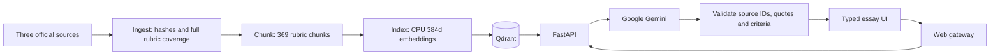

# Stepwise — IELTS writing feedback and model essays

AC215 Milestone 2. Type or paste an IELTS Academic Writing Task 2 essay, receive real rubric-grounded Google Gemini scores and specific revisions, then generate an essay from your target and ideas and inspect its separately assessed scores.

## Live application

[Open Stepwise](https://stepwise-one.vercel.app) — fixed public URL; no Vercel login is required. Bei Li's complete implementation is on the default `bei-li` branch. `milestone2` retains the existing course delivery snapshot.

Vercel hosts the UI and a same-origin gateway. A restricted, short-lived OIDC identity invokes the private Cloud Run API, whose service account calls Gemini on Vertex AI. The frozen official RAG index contains 369 points; Google credentials are not embedded in the browser.

## Team branches

| Branch | Owner / purpose | Starting contents |
| --- | --- | --- |
| [`bei-li`](https://github.com/dwcqwcqw/stepwise/tree/bei-li) | Bei Li; default view | Complete implementation, report and evidence |
| [`ernest-ferdian`](https://github.com/dwcqwcqw/stepwise/tree/ernest-ferdian) | Ernest Ferdian | Empty workspace |
| [`dimitris-pipinis`](https://github.com/dwcqwcqw/stepwise/tree/dimitris-pipinis) | Dimitris Pipinis | Empty workspace |
| [`xiahui-huang`](https://github.com/dwcqwcqw/stepwise/tree/xiahui-huang) | Xiahui Huang | Empty workspace |
| [`main`](https://github.com/dwcqwcqw/stepwise/tree/main) | Shared team integration | Empty workspace |
| [`milestone2`](https://github.com/dwcqwcqw/stepwise/tree/milestone2) | Existing course delivery snapshot | Preserved implementation and submission artifacts |

Member branches provide separate places for development; repository access is managed through GitHub collaborators.

## Run

See [setup instructions](docs/setup.md) for authorized Google Cloud configuration, runtime token refresh and exact commands. With those prerequisites configured:

```bash
make run
```

[Official milestone requirements](https://harvard-iacs.github.io/2026-AC215/milestone2/) · [Application design](docs/application.md) · [Sources and coverage](docs/data.md) · [Engineering decisions](docs/decisions.md) · [Evidence](docs/evidence/README.md)

## Pipeline



Five custom Dockerfiles, five `pyproject.toml`/`uv.lock` pairs and upstream Qdrant are composed in `compose.yaml`. Source locks, chunk manifests, embedding fingerprints and model-call receipts identify what each stage used.

## Official assessment knowledge

All nine pages of the official IELTS Writing Band Descriptors are indexed, including bands 0–9 for both tasks. Task 2 scoring retrieves only applicable Task 2/shared rules. The PDF is split into 238 paragraph statements (119 for Task 2), with independent vectors, parent cells and exact page links. Each of the four independent assessment calls checks every official integer band and its bold limiting features. The UI prioritizes current/next-band matches and shows the exact criterion mean before half-up conversion to a 0.5 practice estimate. The official Key Assessment Criteria supplies 20 supplementary skill checks. British Council guidance adds question-relevance examples. See [linked sources](docs/data.md).

Four criterion scores, exact essay evidence, actionable advice and before/after revisions are generated by the model. Source citations and excerpts are checked on the server. Generation preserves requested position/ideas and is followed by a fresh assessment that does not receive the target band.

The 8,049 candidate essay records are **MS3 fine-tuning data**, excluded from MS2 ingestion and RAG. Only their future-use manifest is retained in `data/ms3`.

## Validation

`make test` checks contracts and evidence validation without Google calls. `make verify` tests the live containers and model workflow. `make evidence` records existing validated outputs and logs without additional inference. Current receipts identify the exact model and implementation used; successful integration does not establish agreement with examiner scores.

Historical preview evidence is preserved under `docs/evidence/preview-v1/`; it describes the earlier placeholder implementation and must not be used as proof of current model inference.

Team: Bei Li, Ernest Ferdian, Dimitris Pipinis, Xiahui Huang.

## Verified delivery

The cloud run on 11 October 2026 used `stepwise-ac215-20261010` and `gemini-3.8-flash`: 131 indexed points, 40 retrieval cases, 12 live workflow checks and 18 local tests passed. Draft scores were 8.0 for the authored sample and 3.0 for a distinct weak draft; a target-7.0 model essay was separately assessed 9.0. These are integration observations; scoring agreement and target deviation still require evaluation.

[MS2 report](docs/report.md) · [Report PDF](docs/Stepwise_MS2_Report.pdf) · [Eight-slide presentation](docs/slides/Stepwise_MS2_Presentation_Final.pptx) · [Google Docs report](https://docs.google.com/document/d/1zz4xZyHuphKdB_hXu1w4R4tl9ldOu46OoDFS8vkZt5Q/edit)

## Public deployment verification

On 11 October 2026, the fixed Vercel URL completed live draft feedback and model-essay generation with separate assessment. The 273-word sample received 8.0 on all four criteria; a target-7.0 essay was generated at 305 words and separately assessed 9.0. This verifies the deployed workflow and records target overshoot; it is not a calibration benchmark. The deployment uses source commit `95b921c8e19d81280bb7c15d173cdf19c4f841c8` and Cloud Run revision `stepwise-api-00001-pk4`. Twenty-one local tests passed.

[Deployment details](deploy/README.md) · [Deployment receipt](docs/evidence/public-deployment.json) · [Live feedback](docs/evidence/public-feedback.png) · [Live generated essay](docs/evidence/public-model-essay.png)
