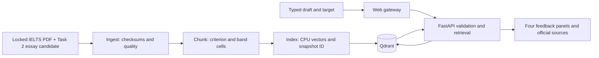

# Stepwise · IELTS Writing Feedback & Model Essays

**AC215 Fall 2026 — Milestone 2: MLOps Infrastructure**

Stepwise helps IELTS candidates revise typed/pasted academic argument essays against four criteria, then request a model essay preserving their ideas and targeting their desired band. MS2 delivers the infrastructure and initial application. Calibrated scoring, personalized model feedback and full essay generation follow in MS3.

## Run the whole system

Requirements: Docker Engine/Desktop with Compose v2+, Python 3.12 (3.10+ works for host verification), Make, approximately 4 GB available RAM and 4 GB free disk. No API key, GPU or billing project is needed for MS2.

```bash
git clone --branch milestone2 https://github.com/dwcqwcqw/stepwise.git
cd stepwise
make run
```

Open **http://localhost:8080**. API docs: **http://localhost:8000/docs**. First run downloads locked sources, CPU weights and images; later runs reuse caches. The command fails if source checksums, extraction, indexing or verification fails.

```bash
make verify       # real gateway -> API -> embeddings -> Qdrant checks
make evidence     # collect logs, manifests and sample input/output
make test         # uv-managed offline contract/chunk tests
make logs
make stop         # stop containers; retain data/model/DB storage
```

## Architecture



| Component | Files | Output |
|---|---|---|
| Ingest | `services/ingest/` | Pinned sources, normalized essays, 24 official rubric cells, quality manifest |
| Chunk | `services/chunk/` | Content IDs and intact criterion-band chunks |
| Index | `services/index/` | 384-dimensional BGE vectors, versioned Qdrant collection, retrieval artifact |
| API | `services/api/` | Validated feedback, retrieval and model-essay endpoints |
| Web | `services/web/` | Four-step interface and same-origin gateway |
| Vector DB | `compose.yaml` | Pinned Qdrant server; persistent private storage |

Every custom container has its own `Dockerfile`, `pyproject.toml` and `uv.lock`; `uv sync --frozen` installs exact dependencies. Qdrant is an upstream prebuilt service, so it has no Python project. Compose requires successful ingest -> chunk -> index completion before API/web startup. The browser cannot connect directly to the DB.

## Working application

1. **Draft:** type/paste question and essay, select band 4–9, or load a clearly labeled authored sample.
2. **Feedback:** four criterion tabs show exact draft quotes, curated practice suggestions, illustrative rewrites and retrieved official source pages. Scores remain empty until MS3's model is connected.
3. **Goals:** submit target band, position and ideas to preserve to the backend.
4. **Model essay:** inspect/download the backend writing brief and rubric context. Full essay generation and separate scoring are explicitly pending MS3.

These are real HTTP interactions and vector queries. Practice templates are not claimed as model-generated diagnoses. There is no image upload or OCR.

## Data and retrieval

`data/sources.lock.json` pins URLs, upstream revision, role, reuse notes and SHA-256. Changed sources fail validation. See [data management](docs/data.md).

- **Official knowledge:** [IELTS Writing Band Descriptors, May 2023](https://ielts.org/cdn/ielts-guides/ielts-writing-band-descriptors.pdf), Task 2 tables on PDF pages 7–9, four criteria, bands 4–9. Preserve complete cells rather than arbitrary text windows.
- **Separate adaptation candidate:** [chillies/ielts-writing-task2-essays](https://huggingface.co/datasets/chillies/ielts-writing-task2-essays), immutable revision `fa42fa7a2b02941e002cfbf5146c3176ba21f413`. Validate schema, remove exact essay duplicates and split by normalized prompt. Training remains gated on reuse/provenance audit; candidate essays and generated advice never enter the official-rubric index.
- **Embedding:** `BAAI/bge-small-en-v1.5`, FastEmbed 0.7.3, CPU ONNX, 384 dimensions. Record actual ONNX checksum and derive index ID from model/config/chunk snapshot.
- **Retrieval filter:** task + criterion + target band. Target 6.5 retrieves bands 6 and 7. Similarity ranks matching descriptors; it does not score an essay.

Raw data and credentials are not committed. Small attributed retrieval artifacts and quality receipts provide evidence.

## MS2 deliverable map

| Requirement | Implementation / evidence |
|---|---|
| Virtual environment and setup screenshot | Five uv locks/Dockerfiles; [setup](docs/setup.md); `docs/evidence/` screenshot |
| One-command pipeline | `make run`, Compose, actual `pipeline.log` |
| Data/version tracking | Source SHA-256, data/chunk/index manifests and service handoff files |
| Collection, chunking, vectorization, DB | Ingest -> chunk -> index; Qdrant official-rubric collection |
| Complete retrieval example | `docs/evidence/retrieval_example.json`: query, filters, similarities and source pages |
| Sample input -> output | `data/sample_essay.json`, feedback output and verification summary |
| Mock-up + working UI/backend | Four screens; [app design](docs/application.md); screenshots and request artifacts |
| Submission | `milestone2` branch; full final commit SHA on Canvas |
| 15-minute TF presentation | [Presentation guide](docs/presentation.md); shared understanding of every component |

This is the LLM track. Vision baseline requirements do not apply to this text-only application. MS2 asks for initial RAG and an app skeleton; trained scoring is the next stage.

## References and credit

We studied [Cheese App v0](https://github.com/dlops-io/cheese-app-v0) for stage separation and containerized RAG/UI integration, and [babykev](https://github.com/rahuldave/babykev) for uv locks, contracts and separate smoke/unit checks. Stepwise has its own implementation; no cheese data or credentials are copied. [Design decisions](docs/decisions.md) explain the differences.

[Official MS2 requirements](https://harvard-iacs.github.io/2026-AC215/milestone2/) · [MS2 report](docs/report.md)

Team Stepwise: Bei Li, Ernest Ferdian, Dimitris Pipinis, Xiahui Huang.

## Submission package

- [English report](docs/report.md) · [Google Docs report](https://docs.google.com/document/d/1zz4xZyHuphKdB_hXu1w4R4tl9ldOu46OoDFS8vkZt5Q/edit)
- [TF presentation slides](docs/slides/Stepwise_MS2_Presentation_Final.pptx) · [15-minute walkthrough](docs/presentation.md)
- [Actual execution evidence](docs/evidence/README.md)


