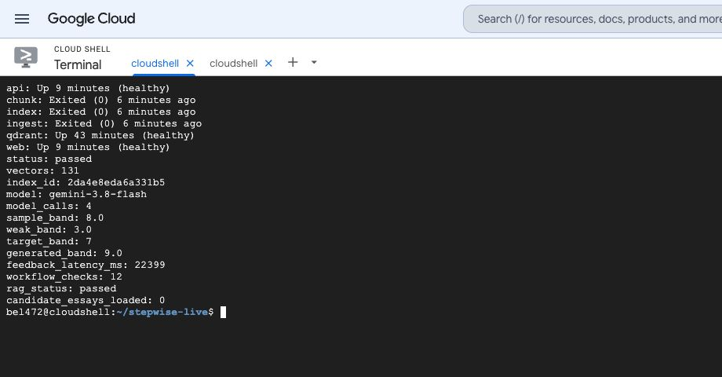
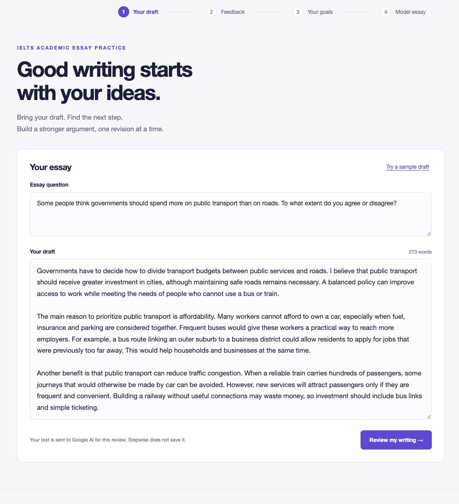
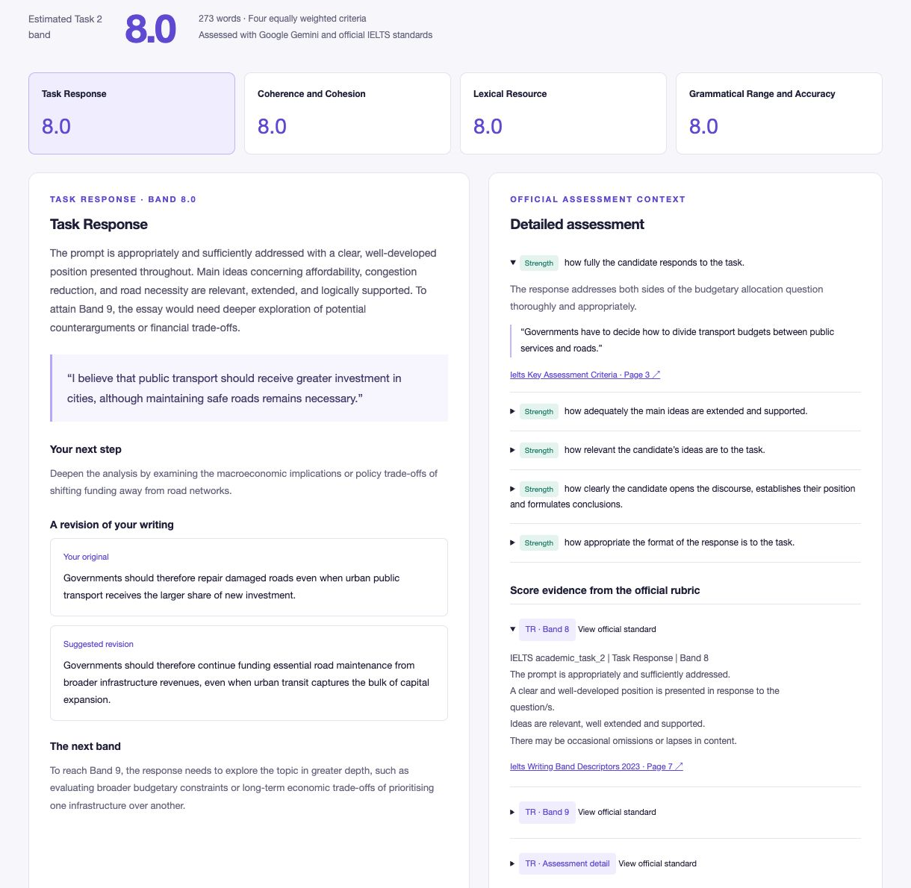
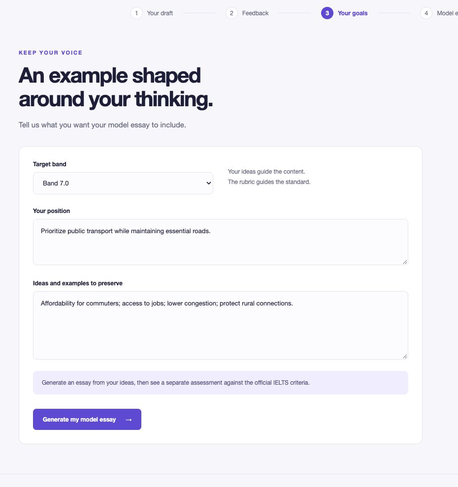
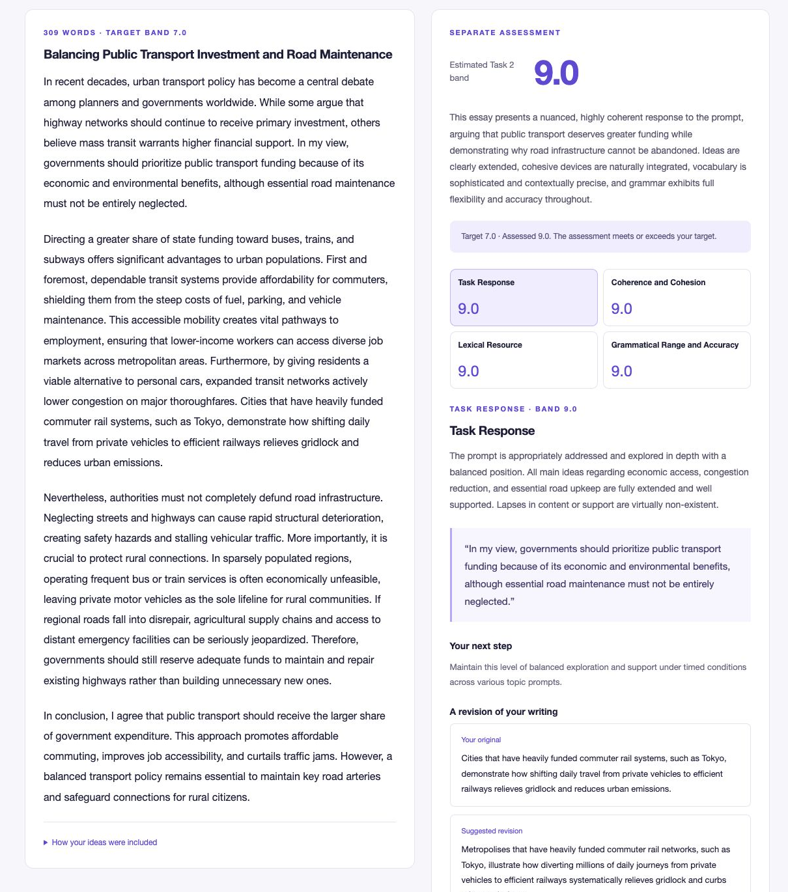

# Stepwise

## Milestone 2 · MLOps Infrastructure

AC215 · Fall 2026 · Live implementation verified 11 October 2026

Team: Bei Li · Ernest Ferdian · Dimitris Pipinis · Xiahui Huang

## 1. Scope and milestone coverage

Stepwise helps IELTS Academic Writing Task 2 learners revise argumentative essays. Users type or paste a question and draft, receive four criterion scores with specific improvements, then enter a target band, position and ideas to generate a complete model essay with a separate assessment. Task 2 offers a consistent argumentative task for rubric-based analysis and later adaptation.

MS2 delivers a working Google Gemini application, official-source RAG, a reproducible container pipeline and real execution evidence. The text-only project follows the LLM track; image upload and OCR are outside scope.

- Environment and containers: an actual Cloud Shell Linux VM; five Dockerfiles and five pyproject.toml/uv.lock pairs; Compose orchestration and make run.

- LLM pipeline: source collection, chunking, embedding, persistent Qdrant integration, logged retrieval and sample input/output artifacts.

- Application and presentation: a four-screen wireframe, working UI/backend, screenshots and an eight-slide, 15-minute TF walkthrough. Deliverables are on the milestone2 branch; Canvas requires its full commit hash.

Requirements: [AC215 Milestone 2](https://harvard-iacs.github.io/2026-AC215/milestone2/).

## 2. Architecture and cloud environment

Data: ingest → chunk → embed/index → Qdrant. Application: browser → web gateway → FastAPI → retrieved official context → Vertex AI Gemini → validated feedback. Successful data stages and health checks gate startup.

Each custom service uses Python 3.12.11 and frozen uv 0.6.4 environments; Qdrant uses v1.15.4. API/web bind to loopback; the database has no published host port. The dedicated project stepwise-ac215-20261010 is active under Harvard’s self-paid folder, with billing and Vertex AI enabled. Cloud Shell supplies the temporary development VM and authenticated preview.

## 3. Official knowledge and reproducible RAG

Only three official resources enter MS2. Downloads are SHA-256 checked against data/sources.lock.json. Full PDFs and extracted text stay in ignored runtime storage.

- [IELTS Writing Band Descriptors](https://ielts.org/cdn/ielts-guides/ielts-writing-band-descriptors.pdf) (May 2023): all nine pages, both tasks and bands 0–9; 80 criterion-band cells, including the merged Band 0 rule and limiting features.

- [IELTS Writing Key Assessment Criteria](https://ielts.org/cdn/ielts-guides/ielts-writing-key-assessment-criteria.pdf): definitions and 20 detailed checks—Task Response 5; Coherence and Cohesion 5; Lexical Resource 6; Grammatical Range and Accuracy 4.

- [British Council: Answer the Question](https://takeielts.britishcouncil.org/sites/default/files/writing_task_2_-_answer_the_questions.pdf): ten pages of official question-analysis and relevance guidance. This older teaching material supplements the current descriptors.

The index has 131 chunks: 80 band cells, 20 detailed checks, five definitions, seven rating rules, nine descriptor pages and ten teaching pages. Whole cells and bullets preserve qualifications; overlap is zero. Page chunks retain full PDF coverage. Metadata records task, criterion, band, page, source URL/hash and stable chunk ID.

Both tasks are indexed for complete source coverage; scoring retrieves only Task 2/shared rules. A mandatory filtered retrieval obtains all 40 Task 2 band cells, all detailed checks and applicable rules. Semantic retrieval adds supplementary teaching context. This prevents top-k search from omitting a criterion or lower band. Generation receives the target-band descriptors; assessment receives the complete band ladder.

FastEmbed 0.7.3 runs BAAI/bge-small-en-v1.5 as CPU ONNX: 384 dimensions and cosine distance. Qdrant stores collection stepwise_2da4e8eda6a331b5. Source snapshot: 3aea32a1828dd022; chunk snapshot: 52814016b8103614; index: 2da4e8eda6a331b5. The manifest records the actual weight hash and dependency versions; stable UUIDs support idempotent upserts.

Retrieval example: POST /api/retrieve with criterion TR, target_band 6.5 and a query about developing examples returns only Task 2 TR descriptors for bands 6 and 7, with text, source/page links and similarity values. The request and complete response are saved in docs/evidence/retrieval_example.json. Similarity selects context; it is not an essay score.

The 8,049 candidate essays are reserved for MS3 fine-tuning. MS2 loads zero candidate records; only a future-use manifest is retained in data/ms3. A regional British Council download block was resolved by caching the exact official PDF, with its locked hash still verified.

## 4. Real model workflow and application

The verified model is gemini-3.8-flash on Google Vertex AI. Structured JSON, bounded retries and server checks require all four criteria, all 20 qualitative checks, known source IDs, awarded/next-band descriptors and exact quotations from the submitted essay. Each criterion includes a rationale, improvement step and before/after example. Failed validation triggers one repair attempt; unchecked results are rejected.

The assessor sees only the question, essay and official context. The target band is withheld. Four integer criterion scores are equally weighted and rounded to a half-band Task 2 estimate. Detailed checks are qualitative observations, not separately scored bands.

The four screens are Draft → Feedback → Goals → Model Essay. Generation uses the target, position and requested ideas; a fresh assessment then receives only the question and resulting essay. The UI shows target and assessed score separately, official citations and idea-coverage notes. Screenshots below show the running application. Learner text is not persisted by Stepwise; Google receives it for inference. Runtime authorization uses short-lived gcloud tokens in a private memory-backed directory, mounted read-only to the API.

## 5. Verification and exact reproduction

Eighteen local contract/evidence tests passed. The live integration receipt passed 12 workflow checks, including real scoring, all detailed checks, exact excerpts, separate model-essay assessment and invalid-input rejection. A separate RAG check verified 131 points, 80 band cells, 20 detailed checks, all 40 criterion-band retrieval cases and the 6.5 boundary.

Observed outputs: the 273-word sample received 8.0; a distinct weak draft received 3.0. The generated essay requested 7.0 and received 9.0 in a separate call. The four-call integration run recorded 22.4 seconds for draft feedback. These are observed outputs, not benchmark accuracy, guaranteed target matching or a latency distribution. Model version, response IDs, token usage and source/index lineage are in docs/evidence.

```bash
git clone --branch milestone2 https://github.com/dwcqwcqw/stepwise.git
cd stepwise
export GOOGLE_CLOUD_PROJECT=stepwise-ac215-20261010
export STEPWISE_AUTH_DIR=/dev/shm/stepwise-auth
python3 scripts/cloud-auth.py > /tmp/stepwise-auth.log 2>&1 &
make run
```

Prerequisites: Docker/Compose, make, Python 3, an authorized gcloud session and an enabled billing/Vertex project. Open localhost:8080 or Cloud Shell Web Preview on port 8080. docs/setup.md contains full configuration and troubleshooting. make verify repeats real model calls; make evidence captures existing outputs/logs; make test runs without Google calls. The Cloud Shell preview is temporary.

## 6. Vercel deployment

Frontend preview: [Stepwise on Vercel](https://stepwise-6lbri9nsq-baileys-projects-7e3a3dc4.vercel.app). The deployment reached READY on 11 October 2026 and is protected by Vercel authentication. Its shared UI source and Node gateway were uploaded from commit 2e97c6e20c48ed20a0d6b102508ca044e298c72a; 21 local tests passed. The source-file deployment is linked to that commit in metadata; GitHub automatic deployment is not configured because the Vercel GitHub integration is not installed.

Prepared cloud connection: Vercel → short-lived OIDC identity → private Cloud Run → Vertex AI. The Cloud Run image uses a frozen export of all 131 official rubric vectors and the pinned embedding model. Dedicated runtime, invoker and build identities separate permissions. Google credentials are not placed in frontend code.

Current boundary: Cloud Run deployment and its restricted IAM trust await owner approval. Browser verification also awaits Vercel login. The Vercel preview has not yet passed end-to-end model assessment; the earlier Cloud Shell scoring and generation evidence remains valid. Deployment scripts, configuration and checks are in deploy/README.md.

## 7. MS3 development and references

Next: audit reliable Task 2 adaptation data, label provenance and prompt-family leakage; compare prompting, official RAG and an open-model LoRA baseline. Track criterion MAE, within-0.5-band agreement, repeated-run variance, target-band deviation, latency and token cost. Current samples establish integration; high generated scores and target overshoot require held-out calibration. Persistent hosting, production authentication and load evaluation follow in later milestones.

Reference implementations: [cheese-app-v0](https://github.com/dlops-io/cheese-app-v0) informed pipeline separation; [babykev](https://github.com/rahuldave/babykev) informed reproducible environments and explicit checks. Stepwise supplies its own IELTS parsing, retrieval contracts and UI. Team members should understand the entire implementation.

Code, receipts and presentation: [Stepwise milestone2 branch](https://github.com/dwcqwcqw/stepwise/tree/milestone2). Verified implementation: c4522d75b45c2ae32a73b0b5c133ccfcb5e43a71. The final branch also includes this report and the refreshed evidence.

## Figure 1. Running cloud environment



Actual Cloud Shell VM: API, web and Qdrant are healthy; ingest/chunk/index exit 0. The real model integration passes with 131 vectors. Full logs and manifests accompany the repository.

## Figure 2. Your draft



One editor accepts a typed or pasted question and essay, with a sample draft and live word count. The decorative panel, initial target sidebar and image/OCR controls are absent.

## Figure 3. Criterion feedback and official detail



The live sample receives 8.0. Exact essay evidence, a specific revision and an example appear beside official detailed checks and retrieved band descriptors. Source links open the original PDF page.

## Figure 4. Your goals



The learner specifies a target band, position and ideas to preserve before generating the model essay.

## Figure 5. Generated essay and separate assessment



Detail from the running model-essay screen: complete prose and a separate four-criterion assessment. Target 7.0 and assessed 9.0 remain distinct. The full screen and JSON output include detailed checks, revisions and linked standards.
