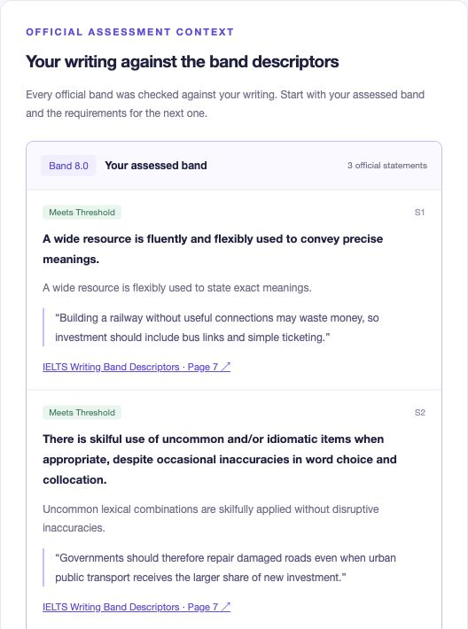

# Stepwise

## Milestone 2 · MLOps Infrastructure

AC215 · Fall 2026 · Live implementation verified 11 October 2026

Team: Bei Li · Ernest Ferdian · Dimitris Pipinis · Xiahui Huang

## 1. Scope and milestone coverage

Stepwise helps IELTS Academic Writing Task 2 learners revise argumentative essays. Users type or paste a question and draft, receive four criterion scores with specific improvements, then enter a target band, position and ideas to generate a complete model essay with a separate assessment. Task 2 offers a consistent argumentative task for rubric-based analysis and later adaptation.

MS2 delivers a working Google Gemini application, official-source RAG, a reproducible container pipeline and real execution evidence. The text-only project follows the LLM track; image upload and OCR are outside scope.

### Project links

GitHub repository: https://github.com/dwcqwcqw/stepwise

Current implementation: https://github.com/dwcqwcqw/stepwise/tree/bei-li

MS2 snapshot branch: https://github.com/dwcqwcqw/stepwise/tree/milestone2

Live frontend: https://stepwise-one.vercel.app

Requirements: https://harvard-iacs.github.io/2026-AC215/milestone2/

### Requirement 1 — Virtual environment (Objective + Deliverable)

Implementation: Cloud Shell provides the Linux VM for Docker development; the deployed API runs in a Cloud Run container. docs/setup.md documents prerequisites, authorization, build, startup and troubleshooting.

Evidence: Figure 1 and docs/evidence/cloud-running.png show the running development environment; pipeline.log records healthy API/web/Qdrant and successful data stages. deploy/README.md explains production setup.

### Requirement 2 — End-to-end containers (Objective + Deliverables)

Implementation: services/{ingest,chunk,index,api,web} each has a Dockerfile, pyproject.toml and uv.lock. compose.yaml orders ingestion → chunking → indexing → API → web, with Qdrant health checks. After the documented environment/auth setup, make run starts the complete pipeline.

Data versions: official source snapshot f58ab6f2ce4fb7a9; paragraph chunk snapshot 6f021ec96cdbaa7a; index 34ed51cdcb06ed7c. Ingestion, chunking and index manifests record lineage and pinned dependencies; the API consumes the resulting 359-point official corpus.

Evidence: docs/setup.md provides exact commands. Historical pipeline/sample receipts remain versioned; docs/evidence/two-source-cleanup.json records the active 359-point index and its approved source counts.

### Requirement 3 — LLM RAG (Objective + Deliverables)

Implementation: ingestion verifies official PDFs; chunking extracts each PDF paragraph while retaining its criterion, integer band, qualifications, bold limits and parent cell. Indexing embeds all 359 records in Qdrant. Mandatory Task 2 retrieval preserves the complete scoring ladder; only the two approved official PDFs contribute context.

Evidence: docs/evidence/retrieval_example.json contains the query, filters and returned source text/page links; rag_verification.json checks all 40 Task 2 criterion-band cases. Section 3 explains chunking, embeddings, database integration and the complete retrieval example.

### Requirement 4 — Vision / other modalities

Not applicable to this text-only LLM project. Users type or paste essays. The 8,049 candidate records and open-model adaptation are reserved for MS3; they are excluded from MS2 retrieval.

### Requirement 5 — App mock-up and working skeleton (Objective + Deliverable)

Implementation: docs/wireframe.md and Figures 2–5 cover Draft → Feedback → Goals → Model Essay. services/web and services/api implement real UI/backend interaction. MS1 refinements include removing image/OCR input and decorative panels, adding complete band-by-band paragraph matching alongside 20 official skill checks, and separating target-band generation from target-blind assessment.

Evidence: the public frontend supports real grading, criterion-specific advice/examples, official citations and full essay generation with a separate assessment. Screenshots, model outputs and public request logs are under docs/evidence.

### Submission and TF presentation

The milestone2 branch preserves the earlier course snapshot; bei-li contains the current implementation and revised evidence. Record the full commit actually selected for submission on Canvas by 10:00 PM ET, October 20. This report does not submit to Canvas. The presentation remains under docs/slides; every member should understand the code, infrastructure, tests and design choices.
## 2. Architecture and cloud environment

Data: ingest → chunk → embed/index → Qdrant. Application: browser → web gateway → FastAPI → retrieved official context → Vertex AI Gemini → validated feedback. Successful data stages and health checks gate startup.

Each custom service uses Python 3.12.11 and frozen uv 0.6.4 environments; the Compose Qdrant server uses v1.15.4. Compose API/web bind to loopback and the database has no published host port. The dedicated project stepwise-ac215-20261010 is active under Harvard’s self-paid folder, with billing and Vertex AI enabled. Cloud Shell supplies the temporary development VM; the stable public application uses Vercel and a private Cloud Run API.

## 3. Official knowledge and reproducible RAG

Only two official resources enter MS2. Downloads are SHA-256 checked against data/sources.lock.json. Full PDFs and extracted text stay in ignored runtime storage.

- [IELTS Writing Band Descriptors](https://ielts.org/cdn/ielts-guides/ielts-writing-band-descriptors.pdf) (May 2023): all nine pages, both tasks and bands 0–9; 80 parent cells and 238 paragraph statements (119 for Task 2), including the merged Band 0 rule and limiting features.

- [IELTS Writing Key Assessment Criteria](https://ielts.org/cdn/ielts-guides/ielts-writing-key-assessment-criteria.pdf): definitions and 20 detailed checks—Task Response 5; Coherence and Cohesion 5; Lexical Resource 6; Grammatical Range and Accuracy 4.


The index has 359 chunks: 238 paragraph statements, 80 parent band cells, 20 skill checks, five definitions, seven rating rules, nine descriptor pages. All 80 cells pass an exact comparison between table text and concatenated paragraphs. Task 2 contributes 119 statements: TR 32, CC 33, LR 28 and GRA 26. Each statement retains its source hash, PDF page and stable parent/child IDs.

Both tasks are indexed for source coverage; scoring retrieves only Task 2/shared rules. It receives all 40 Task 2 band cells with their 119 statements, definitions and applicable limits. Semantic top-k cannot discard lower bands. Generation receives the requested-band context; each subsequent assessment receives the complete target-blind ladder.

FastEmbed 0.7.3 runs BAAI/bge-small-en-v1.5 as CPU ONNX: 384 dimensions and cosine distance. Qdrant collection: stepwise_34ed51cdcb06ed7c. Source snapshot: f58ab6f2ce4fb7a9; chunk snapshot: 6f021ec96cdbaa7a. Weight hashes, dependency versions, stable UUIDs and exact point counts make the corpus reproducible.

Retrieval example: POST /api/retrieve with criterion TR, target_band 6.5 and a query about developing examples returns only Task 2 TR descriptors for bands 6 and 7, with text, source/page links and similarity values. The request and complete response are saved in docs/evidence/retrieval_example.json. Similarity selects context; it is not an essay score.

The 8,049 candidate essays are reserved for MS3 fine-tuning. MS2 loads zero candidate records; only a future-use manifest is retained in data/ms3.

## 4. Real model workflow and application

Google Vertex AI gemini-3.8-flash assesses TR, CC, LR and GRA independently in parallel. Each call evaluates all ten integer bands, every paragraph statement and every bold limiting feature, with explanations and exact essay references. The server derives the highest fully supported band subject to applicable limits, and rejects a model score inconsistent with those matches. Missing, duplicate, skipped or cross-band checks and invented excerpts are rejected. One repair is allowed per criterion. Gaps must follow official wording without adding specialist-topic prerequisites.

The target band is withheld from assessment. Four integer criterion scores have equal weight; the exact mean is displayed before half-up conversion to a 0.5 Task 2 practice estimate. For example, (3 + 4 + 3 + 3) / 4 = 3.25 → 3.5. Official descriptor rows are integer bands; neither half-band descriptors nor numerical paragraph sub-scores are invented. The [official .25/.75 explanation](https://ielts.org/take-a-test/your-results/ielts-scoring-in-detail) concerns the overall four-skill IELTS result; Stepwise labels this task-only conversion explicitly.

The four screens are Draft → Feedback → Goals → Model Essay. Generation uses the target, position and requested ideas; a fresh assessment receives only the question and resulting essay. The UI separates target and assessed scores, official citations and idea-coverage notes. Learner text is not persisted by Stepwise; Google receives it for inference. Compose uses short-lived gcloud tokens in a private memory-backed directory. Production uses Vercel OIDC and the Cloud Run runtime identity; it requires no running Cloud Shell token helper.

## 5. Verification and exact reproduction

151 local tests pass, including guards against extra sources and stale or contaminated deployment bundles. The deployed release passes 40 criterion-band HTTP retrieval cases and a half-band 6.5 query returning both Band 6 and Band 7. The active corpus retains 80 cells, 238 paragraph vectors and all 119 Task 2 statements. See docs/evidence/two-source-tests.txt, two-source-http.json and two-source-cleanup.json.

Observed container outputs: the 273-word sample received 8.0; the weak draft received TR 3, CC 4, LR 3 and GRA 3, producing 3.25 → 3.5; a target-7.0 model essay was independently assessed 9.0. Draft feedback took 18.8 seconds in this run. These demonstrate complete execution, rather than scoring accuracy or guaranteed target matching; response IDs and calculations are in docs/evidence/band-matching-integration.json.

```bash
git clone --branch bei-li https://github.com/dwcqwcqw/stepwise.git
cd stepwise
export GOOGLE_CLOUD_PROJECT=stepwise-ac215-20261010
export STEPWISE_AUTH_DIR=/dev/shm/stepwise-auth
python3 scripts/cloud-auth.py > /tmp/stepwise-auth.log 2>&1 &
make run
```

Prerequisites: Docker/Compose, make, Python 3, an authorized gcloud session and an enabled billing/Vertex project. Open localhost:8080 or Cloud Shell Web Preview on port 8080. docs/setup.md contains full configuration and troubleshooting. make verify repeats real model calls; make evidence captures existing outputs/logs; make test runs without Google calls. The Cloud Shell preview is temporary.

## 6. Public deployment and verification

Live application: https://stepwise-one.vercel.app is public without login. The default bei-li branch holds Bei Li's current implementation; milestone2 retains the earlier course snapshot. Other named member branches and main remain empty starting points. Frontend source: 1dd079987b1157ab732c2aeee821162efdf5c056. Backend source: f42bb8ca2d781dd64f7a281cf090bed01e25faba; Cloud Run revision stepwise-api-00004-c9k serves 100% of traffic. Current screenshots and UI checks are in docs/evidence/band-matching-*. Vercel Git auto-deployment is not configured.

Cloud connection: Vercel → short-lived OIDC identity → private Cloud Run → Vertex AI Gemini. The API loads the frozen 359-point official rubric index and pinned embedding model. Dedicated runtime, invoker and build identities separate permissions. No Google credentials enter frontend code; the deployed service is independent of Cloud Shell.

Final production verification: the 273-word draft received TR 9, CC 9, LR 8 and GRA 8: mean 8.50 → 8.5. A target-7.0 essay contained 317 words and received TR 9, CC 8, LR 9 and GRA 9: mean 8.75 → 9.0. Browser checks compared all 119 official statements in each assessment with the pinned corpus, confirming exact wording, page links and verbatim essay evidence. docs/evidence/band-matching-production-ui.json records these checks against backend f42bb8c and the final deployment. Earlier receipts retain their original source versions; target overshoot remains a calibration task.

## 7. MS3 development and references

Next: audit reliable Task 2 adaptation data, label provenance and prompt-family leakage; compare prompting, official RAG and an open-model LoRA baseline. Track criterion MAE, within-0.5-band agreement, repeated-run variance, target-band deviation, latency and token cost. Current samples establish integration; high generated scores and target overshoot require held-out calibration. Open-model deployment, request limits and load evaluation follow in later milestones.

Reference implementations: [cheese-app-v0](https://github.com/dlops-io/cheese-app-v0) informed pipeline separation; [babykev](https://github.com/rahuldave/babykev) informed reproducible environments and explicit checks. Stepwise supplies its own IELTS parsing, retrieval contracts and UI. Team members should understand the entire implementation.

Current code and new receipts: https://github.com/dwcqwcqw/stepwise/tree/bei-li. The milestone2 branch retains the earlier course snapshot; main and the other member branches remain empty starting points. Historical integration commits stay in Git. Obtain the intended final submission hash with git rev-parse HEAD.

## Figure 1. Running cloud environment


Actual Cloud Shell VM: API, web and Qdrant are healthy; ingest/chunk/index exit 0. This historical environment screenshot shows the earlier 131-point run. The current 359-point corpus is verified in two-source-cleanup.json. Full logs and manifests accompany the repository.

## Figure 2. Your draft


One editor accepts a typed or pasted question and essay, with a sample draft and live word count. The decorative panel, initial target sidebar and image/OCR controls are absent.

## Figure 3. Criterion feedback and band matching



Current-band and next-band statements are shown first, with official wording, explicit judgments, exact essay evidence and Band Descriptors page links. Other bands and supplementary skill checks are expandable. Four equally weighted scores, their exact mean and the half-band estimate are displayed above the feedback.

## Figure 4. Your goals


The learner specifies a target band, position and ideas to preserve before generating the model essay.

## Figure 5. Generated essay and separate assessment


Detail from the running model-essay screen: complete prose and a separate four-criterion assessment. Target 7.0 and assessed 9.0 remain distinct. The full screen and JSON output include detailed checks, revisions and linked standards.
