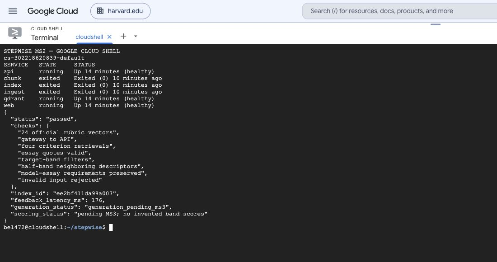
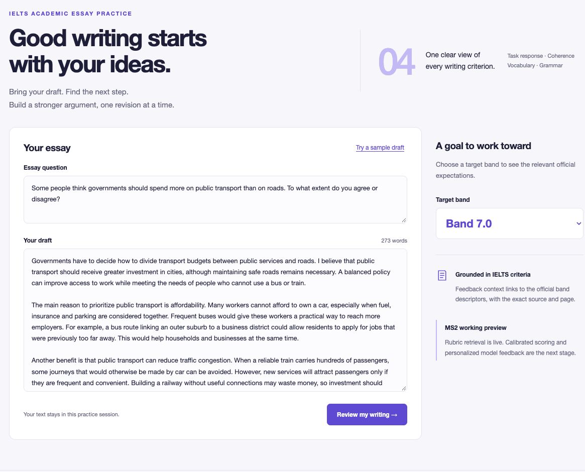
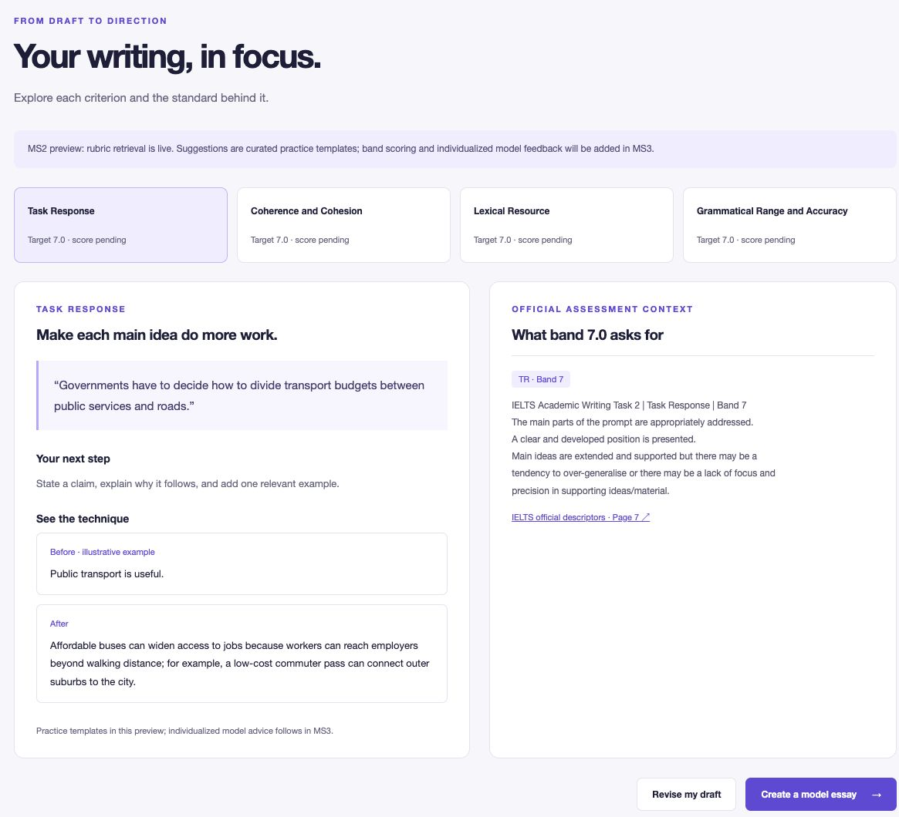
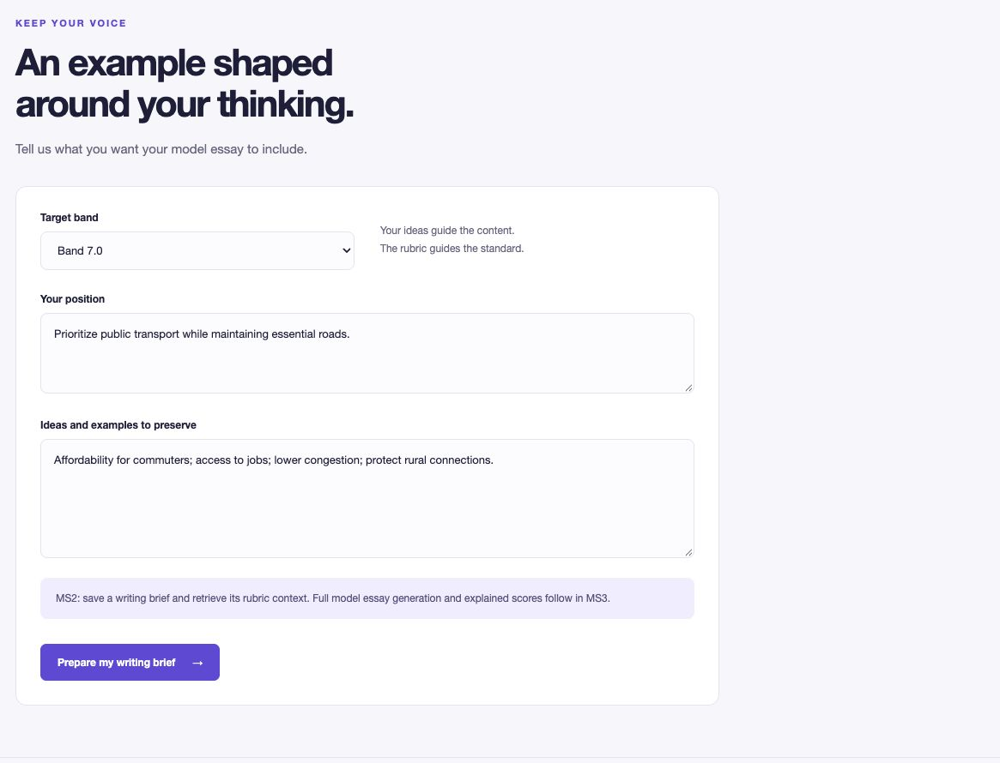
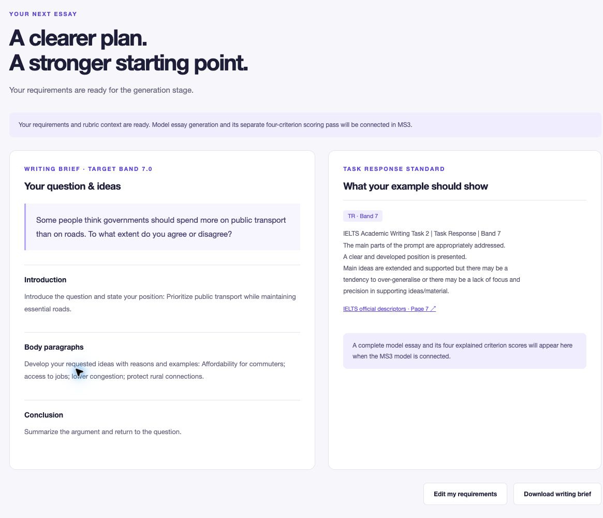

# Stepwise

## Milestone 2 · MLOps Infrastructure

AC215 · Fall 2026 · Implementation verified 10 October 2026

Team: Bei Li · Ernest Ferdian · Dimitris Pipinis · Xiahui Huang

## 1. Project scope and milestone outcome

Stepwise helps learners improve IELTS Academic argumentative essays (Writing Task 2). Learners type or paste a question and draft, explore feedback across four assessment criteria, and specify a target band, position and ideas for a tailored model essay. Task 2 offers a consistent text-based task for rubric-grounded analysis and adaptation.

MS2 establishes the infrastructure: reproducible containers, verified data ingestion, structured rubric chunks, CPU embeddings, a persistent vector database, and a working four-screen application. Official rubric retrieval and UI–backend interaction run end to end. Scoring and full essay generation are explicitly marked as MS3 work; the current advice and illustrative revisions are curated practice templates.

### Requirement coverage

- Environment: an actual Google Cloud Shell Linux VM, setup instructions and a screenshot of running services.

- Containers: five custom Dockerfiles, five pyproject.toml/uv.lock pairs, Compose orchestration, make run, logs and sample input/output artifacts.

- LLM track: collection → chunking → vectorization → Qdrant → a complete query-to-context retrieval example, with source and index versions.

- Application: four-screen wireframe, implemented UI, live backend requests and saved screenshots. The text-only project follows the LLM track.

- Presentation and submission: a 15-minute TF walkthrough, slides and deliverables on the milestone2 branch; the full branch commit hash is the Canvas submission identifier.

Requirement source: [AC215 Milestone 2](https://harvard-iacs.github.io/2026-AC215/milestone2/).

## 2. Architecture and reproducible environment

Data path: ingest → chunk → index → Qdrant. Application path: browser → same-origin web gateway → FastAPI → query embedding and filtered Qdrant search → structured response → rendered feedback or writing brief.

- Ingest downloads or reuses cached sources, verifies SHA-256, extracts official rubric cells, normalizes candidate essays and writes quality/version manifests.

- Chunk preserves each complete criterion–band rubric cell and attaches retrieval metadata. Index embeds those chunks, upserts stable IDs, verifies the point count and publishes the active index manifest.

- API exposes health/readiness, retrieval, feedback and model-essay preparation endpoints. Web serves the UI and proxies requests. Qdrant is the upstream database container.

Each custom service uses Python 3.12.11, a pinned uv 0.6.4 tool, and uv sync --frozen. Libraries are resolved in service-specific lockfiles. Qdrant uses v1.15.4. Compose waits for successful ingestion/chunking/indexing and healthy services before starting the dependent application components.

The pipeline was built and run in the existing authenticated Google Cloud Shell session. This uses its temporary development VM; no new paid Compute Engine instance or billing project was required. The preview uses Cloud Shell’s authenticated proxy. Ports 8000 and 8080 bind to loopback, and Qdrant has no host-published port. Raw datasets, caches and credentials are excluded from Git.

### Exact reproduction commands

```text
git clone --branch milestone2 https://github.com/dwcqwcqw/stepwise.git
cd stepwise
make run
```

Prerequisites: Docker Engine with Compose v2 or newer, make, Python 3 and outbound HTTPS. Host uv is additionally required for make test. Open http://localhost:8080; API documentation is at http://localhost:8000/docs. In Cloud Shell, choose Web Preview → port 8080. The first run downloads images, sources and embedding weights; later runs reuse caches.

```text
make verify    # repeat the live HTTP/vector checks
make evidence  # refresh logs, manifests and sample outputs
make test      # run contract tests
make logs      # inspect service logs
make stop      # stop services; retain runtime data
```

Repository guide: README.md, docs/setup.md and compose.yaml. The screenshot in Figure 1 shows API, web and Qdrant healthy; the three batch stages exit successfully with code 0.

## 3. Data collection, quality and version tracking

### Official knowledge source

[IELTS Writing Band Descriptors](https://ielts.org/cdn/ielts-guides/ielts-writing-band-descriptors.pdf) (May 2023) provide the RAG assessment context. The parser selects tables headed Task Response, excludes Task 1, and extracts all four criteria for bands 4–9: Task Response (TR), Coherence and Cohesion (CC), Lexical Resource (LR), and Grammatical Range and Accuracy (GRA). Exactly 24 nonempty, unique cells are required; missing or duplicate cells fail ingestion.

### Adaptation candidate source

[chillies/ielts-writing-task2-essays](https://huggingface.co/datasets/chillies/ielts-writing-task2-essays) is collected separately for later adaptation research, pinned to Hugging Face revision fa42fa7a2b02941e002cfbf5146c3176ba21f413. The dataset card declares CC BY 4.0. Its underlying reuse and rating provenance still need verification before training; every processed record currently has training_approved=false. Candidate essays, labels and optional GPT advice never enter the official-rubric collection.

Preprocessing requires a nonempty prompt, at least 40 essay words and numeric criterion labels in [0,9]. Original text is preserved; normalized essay hashes detect exact duplicates. The upstream task_achievement_band field is explicitly mapped to Task 2 TR. Essays sharing a case/whitespace-normalized prompt receive the same deterministic split; 80/10/10 hash buckets define the allocation.

### Observed data results

- 8,049 source rows → 8,049 valid unique records; 0 schema-invalid rows and 0 exact duplicates removed.

- 1,794 distinct normalized prompt strings; train 6,677, validation 675, test 697. These are observed row counts, not guaranteed 80/10/10 row proportions.

- 24 official rubric cells → 24 complete chunks → 24 vectors. Chunk lengths range from 260 to 547 characters; overlap is 0.

The prompt count reveals an additional audit need: exact normalization does not merge paraphrased questions or near-duplicate essays. Prompt-family grouping, prompt/essay alignment, score provenance and reuse checks must precede adaptation and a reliable evaluation split. Schema validity alone does not establish label quality.

### Version lineage

data/sources.lock.json pins both source hashes and the immutable essay revision. Ingest reads the source lock and produces snapshot 34cab16e4ffa06d6; chunk reads that manifest and produces snapshot 8b1961bb5f2344e7; index reads the chunk manifest and produces index ee2bf411da98a007; API reads the active index manifest. Model/cache configuration and source/chunk changes therefore remain traceable across containers.

The actual ONNX weight SHA-256 is recorded alongside the model name and dependency versions. The index ID incorporates the chunk snapshot, embedding configuration and weight hash. Stable point UUIDs make repeated upserts idempotent; an exact count check prevents publishing an incomplete index. Full hashes and receipts are in docs/evidence and data/sources.lock.json.

## 4. Chunking, vectorization and retrieval evidence

A whole rubric table cell is the chunk boundary because it represents one complete criterion at one band. Arbitrary fixed-length windows could mix standards or sever a qualification. Each chunk stores text, chunk ID, task, criterion, band, page, source URL/version and checksum. The MVP target range is 4.0–9.0, avoiding the merged lower-band cells.

FastEmbed 0.7.3 runs BAAI/bge-small-en-v1.5 as CPU ONNX, producing 384-dimensional vectors. Qdrant stores them with cosine distance in collection stepwise_ee2bf411da98a007. Query embeddings use the same model. Metadata filters restrict results to Academic Task 2, the requested criterion and the target band; a half-band target retrieves its two neighboring integer descriptors.

### One complete retrieval example

```text
POST /api/retrieve
query: How can I develop and support my position with specific examples?
criterion: TR
target_band: 6.5
top_k: 2
```

The real gateway/API response returns two matching Task Response chunks: bands 6 and 7, both from the official PDF, with source page links, similarity values, complete text and stable chunk IDs. No Task 1 or other criterion is returned. The saved request, filters and response can be inspected in docs/evidence/retrieval_example.json; pipeline.log records ingestion, indexing and a retrieval event.

These matches provide assessment context for the later scoring/generation model. Similarity is not an essay band score. A small structured rubric is appropriate for this initial retrieval contract; a larger knowledge base and a scored relevance benchmark can be added only when they improve the task.

## 5. Application design and actual interaction

The implemented UI retains Stepwise’s white/lilac visual style and four-step progression. Figures 2–5 are screenshots of the running app, rather than generated design concepts. docs/application.md contains the corresponding wireframe and interaction contracts.

- Your draft: type or paste the question and essay, select a target band, or load the authored 273-word transport example. A word count and validation guide submission.

- Feedback: select each of the four criteria to inspect an exact draft quotation, a concrete practice step, an illustrative before/after revision and live official rubric context with a page link. Scores are marked pending, and template advice is labeled.

- Your goals: enter the target band, position and ideas/examples to preserve. These fields are submitted to the backend with the original question.

- Model essay: display the returned writing brief and retrieved TR standard; edit requirements or download the brief. Full generated prose and its separate four-criterion scoring explanation are reserved for the MS3 model integration.

Endpoints validate target bands in half-point increments from 4 to 9, reject empty/invalid inputs, and bound text lengths. The browser escapes dynamic text before rendering. Submitted drafts are not persisted or included in request logs by the application.

## 6. Verification, engineering findings and next steps

### Recorded checks

Nine local unit tests passed, covering input contracts and chunk/version invariants. Eight live checks passed through the web gateway: readiness with 24 vectors, gateway/API connectivity, all four criterion retrievals, valid draft quotations, target-band filtering, neighboring descriptors for 6.5, preservation of model-essay requirements, and HTTP 422 rejection of invalid inputs.

The one-command pipeline was rerun successfully in Cloud Shell and retained the same source, chunk and index IDs with 24 points. Initial execution exposed a transient startup connection reset and a host/container artifact ownership conflict. Readiness retries and atomic artifact replacement resolved them; the final run and evidence refresh succeeded. Captured request timing is a single development observation, not a performance benchmark.

Evidence files include pipeline.log, containers.jsonl, docker-version.json, data_quality.json, chunking.json, index.json, verification.json, sample_input.json, feedback_output.json, retrieval_example.json, and model_essay_request/output.json. Figure 1 independently shows the running environment.

### MS3 development plan

- Approve suitable adaptation data and finalize prompt-family/near-duplicate leakage checks before any model training.

- Compare a general open-weight model, rubric RAG and parameter-efficient adaptation. Track model/data versions, configurations and artifacts.

- Implement criterion scoring, passage-specific improvement advice and revisions, then target-band essay generation with a separate scoring pass.

- Evaluate against reliable held-out labels: criterion MAE, within-0.5-band agreement and repeated-run variance; separately measure retrieval correctness, latency and cost.

Current limits are a development-session deployment, 24 rubric-only vectors, unaudited adaptation candidates, and placeholder scoring/generation. Production authentication, persistent hosting, retention, larger retrieval evaluation and model-serving controls belong to later milestones.

### Reference projects and presentation

[cheese-app-v0](https://github.com/dlops-io/cheese-app-v0) informed the separation of chunking, embedding, vector storage and API application stages. [babykev](https://github.com/rahuldave/babykev) informed frozen environments, explicit contracts, smoke checks and documented experimental boundaries. Stepwise implements its own IELTS data schema, Qdrant retrieval and UI; the teachers’ modeling tasks and framework choices were not copied wholesale.

The included slides and docs/presentation.md organize a 15-minute demonstration of the problem, architecture, data, retrieval trace, live app, reproducibility and next steps. Every team member should be ready to explain all code and design choices.

Code and all deliverables: [Stepwise milestone2 branch](https://github.com/dwcqwcqw/stepwise/tree/milestone2).

Verified implementation commit: 1810c5a031e54ed28cd42740062b340b585d1242. The final submission commit also includes the report, screenshots, logs and slides; use the latest milestone2 branch hash reported with the completed submission package.

## Figure 1. Running environment



Google Cloud Shell: healthy API, web and Qdrant; successful batch stages and eight live checks.

## Figure 2. Your draft



Typed/pasted question and essay, sample input and target-band selection.

## Figure 3. Four-criterion feedback



Criterion tabs, a specific practice step and example revision, with retrieved official assessment context.

## Figure 4. Your goals



A target band, position and user-selected ideas form the model-essay requirements.

## Figure 5. Writing brief and rubric context



Actual backend output preserves the user requirements; generation and scoring are visibly pending MS3.
