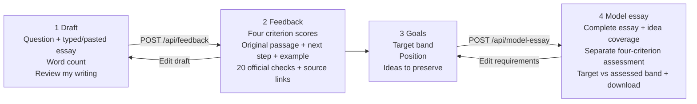

# Stepwise interaction wireframe

Live app: https://stepwise-one.vercel.app

The four views share the same header, numbered navigation, violet accents and criterion cards. The screenshots in the report show the implemented interface; this wireframe describes its structure and interactions.

## 1. Draft

One central editor contains the essay question and draft, with a sample button, live word count and review action. No upload/OCR controls or initial target selector. During the request, the review button is disabled and shows progress. On failure the draft stays in place and an error appears.

## 2. Feedback

The overall estimate and four criterion tabs appear above two panels. The left panel contains the selected criterion's rationale, exact original passage, next step and before/after example. The right panel contains its official subcriteria and awarded/next-band descriptors with PDF page links. Changing tabs updates both panels. A goals action proceeds to generation requirements.

## 3. Goals

Target band, position and ideas are entered together. These fields guide generation; they are withheld from the assessor. The generation button shows progress and preserves the requirements if the request fails.

## 4. Model essay

The main panel displays complete paragraphs and idea-coverage notes. The assessment panel shows a fresh overall estimate, four criterion tabs, detailed feedback and official citations. Target and assessed scores remain separate. Users can edit requirements or download the essay and feedback.

## Refinements from MS1

- Typed/pasted text replaces handwritten/image input.
- Decorative overview panels are removed to give the editor and feedback more space.
- All 20 official detailed checks are inspectable alongside the four criterion scores.
- Generation is followed by a separate target-blind assessment.
- Exact evidence references are resolved by the server to preserve spelling and punctuation.

Implementation: `services/web/static/index.html`, `app.js`, `styles.css`; backend contracts: `services/api/main.py`.
